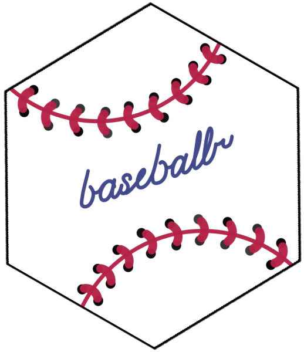

```{r readme_setup, include = FALSE}
# Ensure the packages used in this README are installed (via pak) and loaded.
if (!requireNamespace('pak', quietly = TRUE)){
  install.packages('pak')
}
if (!requireNamespace('dplyr', quietly = TRUE)){
  pak::pak('dplyr')
}
library(dplyr)
```

# **baseballr** <a href='https://billpetti.github.io/baseballr/'></a>

<!-- badges: start -->

[](https://CRAN.R-project.org/package=baseballr)
[](https://CRAN.R-project.org/package=baseballr)
[](https://sportsdataverse.r-universe.dev/baseballr)
[](https://github.com/BillPetti/baseballr/)
[](https://github.com/BillPetti/baseballr/actions/workflows/R-CMD-check.yaml)
[](https://app.codecov.io/gh/BillPetti/baseballr)
[](https://github.com/BillPetti/baseballr/actions/workflows/pkgdown.yaml)
[](https://lifecycle.r-lib.org/articles/stages.html#stable)
[](https://github.com/BillPetti/baseballr/blob/master/LICENSE.md)
[](https://github.com/BillPetti/baseballr/graphs/contributors)
[](https://github.com/BillPetti/baseballr/stargazers)
[](https://x.com/SportsDataverse)
<!-- badges: end -->

`baseballr` is a package written for R focused on baseball analysis. It
includes functions for acquiring data from a range of sources — the
[MLB Stats API](https://statsapi.mlb.com/), [ESPN](https://www.espn.com/)
(MLB and NCAA college baseball), [Fox Sports](https://www.foxsports.com/),
[FanGraphs.com](https://www.fangraphs.com/),
[Baseball-Reference.com](https://www.baseball-reference.com/),
[baseballsavant.mlb.com](https://baseballsavant.mlb.com/), the
[NCAA stats site](https://stats.ncaa.org/), Spotrac, the Chadwick Bureau
register, and Retrosheet. It also includes functions for calculating metrics,
such as wOBA, FIP, and team-level consistency over custom time frames.

You can read more about some of the functions and how to use them at its
[official site](https://billpetti.github.io/baseballr/) as well as this
[Hardball Times
article](https://tht.fangraphs.com/developing-the-baseballr-package-for-r/).

## **Data status**

The `load_*()` functions read release assets on [sportsdataverse-data](https://github.com/sportsdataverse/sportsdataverse-data/releases). The badges below are rebuilt nightly from each producer's latest workflow run and newest release files; idle means the sport is out of season. Full detail: [sportsdataverse.org/status](https://sportsdataverse.org/status).

| Dataset | Data updated | Through | Pipeline | Update workflows |
|:--|:--|:--|:--|:--|
| [MLB and college baseball](https://github.com/sportsdataverse/baseballr-data) | [](https://github.com/sportsdataverse/sportsdataverse-data/releases) | [](https://github.com/sportsdataverse/sportsdataverse-data/releases) | [](https://sportsdataverse.org/status#baseballr-data) | [](https://github.com/sportsdataverse/baseballr-data/actions/workflows/mlb_models_cron.yml) [](https://github.com/sportsdataverse/baseballr-data/actions/workflows/daily_ncaa_baseball.yml) |
| [Conference, division and ballpark reference](https://github.com/sportsdataverse/sdv-reference-data) | [](https://github.com/sportsdataverse/sportsdataverse-data/releases) | [](https://github.com/sportsdataverse/sportsdataverse-data/releases) | [](https://sportsdataverse.org/status#sdv-reference-data) | &mdash; |

## **Installation**

You can install the CRAN version of [**`baseballr`**](https://CRAN.R-project.org/package=baseballr) with:

```r
install.packages("baseballr")
```

You can install the latest build from [R-universe](https://sportsdataverse.r-universe.dev/baseballr) with:

```r
install.packages("baseballr", repos = c("https://sportsdataverse.r-universe.dev", getOption("repos")))
```

You can install the development version of [**`baseballr`**](https://github.com/BillPetti/baseballr/) from GitHub with:

```r
if (!requireNamespace("pak", quietly = TRUE)) install.packages("pak")
pak::pak("BillPetti/baseballr")
# or: remotes::install_github("BillPetti/baseballr")
```

For experimental functions in development, you can install the [development branch](https://github.com/BillPetti/baseballr/tree/development_branch):

```r
pak::pak("BillPetti/baseballr@development_branch")
# or: remotes::install_github("BillPetti/baseballr", ref = "development_branch")
```

## **Quick start**

```r
library(baseballr)

# MLB schedule for a season (level_ids = 1 is the majors)
mlb_schedule(season = 2024, level_ids = "1")

# Statcast pitch-level data for a short date range
statcast_search(start_date = "2024-04-01", end_date = "2024-04-02", player_type = "pitcher")

# Look up a player's ids across MLBAM, FanGraphs, Baseball-Reference and Retrosheet
playerid_lookup(last_name = "Ohtani", first_name = "Shohei")

# Pre-computed Stuff+ from the SportsDataverse data releases
load_mlb_stuff_plus(seasons = 2024)
```

More worked examples are in **Functionality** below and in the [Getting Started](https://billpetti.github.io/baseballr/articles/baseballr.html) vignette.

## **Functionality**

The package consists of two main sets of functions: data acquisition and metric calculation.

Data acquisition spans the MLB Stats API (`mlb_*()`, including situational
splits via `sit_codes`), Baseball Savant / Statcast (`statcast_search()` for
MLB plus `statcast_search_minors()` and `statcast_search_wbc()` for the
minor-league and World Baseball Classic routes), FanGraphs (`fg_*()`),
Baseball Reference (`bref_*()`), ESPN (`espn_mlb_*()`,
`espn_college_baseball_*()`), Fox Sports (`fox_mlb_*()`), NCAA
(`ncaa_*()`), Spotrac (`sptrc_*()`), the Chadwick Bureau register
(`chadwick_*()`), and Retrosheet (`retrosheet_data()`). Pre-computed
season datasets — NCAA schedules/pbp, umpire ids, and eleven MLB model
datasets (expected stats, Stuff+, OAA, catcher framing, run/win
expectancy, and more) — load from the SportsDataverse data releases via
the `load_*()` family.

For example, if you want to see the standings for a specific MLB division on a given date, you can use the `bref_standings_on_date()` function. Just pass the year, month, day, and division you want:

```{r bref_standings_on_date}
library(baseballr)
library(dplyr)
bref_standings_on_date("2015-08-01", "NL East", from = FALSE)
```

Right now the function works as far as back as 1994, which is when both leagues split into three divisions.

You can also pull data for all hitters over a specific date range. Here are the results for all hitters from August 1st through October 3rd during the 2015 season:

```{r bref_daily_batter}

data <- bref_daily_batter("2015-08-01", "2015-10-03") 
data %>%
  dplyr::glimpse()
```

In terms of metric calculation, the package allows the user to calculate the consistency of team scoring and run prevention for any year using `team_consistency()`:

```{r team_consistency}
team_consistency(2015)
```

You can also calculate wOBA per plate appearance and wOBA on contact for any set of data over any date range, provided you have the data available.

Simply pass the proper data frame to `woba_plus`:

```{r woba}
data %>%
  dplyr::filter(PA > 200) %>%
  woba_plus %>%
  dplyr::arrange(desc(wOBA)) %>%
  dplyr::select(Name, Team, season, PA, wOBA, wOBA_CON) %>%
  dplyr::glimpse()
```

You can also generate these wOBA-based stats, as well as FIP, for pitchers using the `fip_plus()` function:

```{r bref_daily_pitcher}
bref_daily_pitcher("2015-04-05", "2015-04-30") %>% 
  fip_plus() %>% 
  dplyr::select(season, Name, IP, ERA, SO, uBB, HBP, HR, FIP, wOBA_against, wOBA_CON_against) %>%
  dplyr::arrange(dplyr::desc(IP)) %>% 
  head(10)
```


## **Issues**

Please leave any suggestions or bugs in the [Issues section](https://github.com/billpetti/baseballr/issues).

## **Pull Requests**

Pull request are welcome, but I cannot guarantee that they will be accepted or accepted quickly. Please make all pull requests to the [development branch](https://github.com/billpetti/baseballr/tree/development_branch) for review.

## **Documentation**

- [Package site](https://billpetti.github.io/baseballr/)
- [Function reference](https://billpetti.github.io/baseballr/reference/index.html)
- Vignettes:
  - [Getting Started with baseballr](https://billpetti.github.io/baseballr/articles/baseballr.html)
  - [NCAA Scraping](https://billpetti.github.io/baseballr/articles/ncaa_scraping.html)
  - [Plotting Statcast data](https://billpetti.github.io/baseballr/articles/plotting_statcast.html)
  - [Using Statcast Pitch Data](https://billpetti.github.io/baseballr/articles/using_statcast_pitch_data.html)
- [News and release notes](https://billpetti.github.io/baseballr/news/index.html)

## **Breaking Changes**

[**Full News on Releases**](https://billpetti.github.io/baseballr/news/index.html)

## **Companion packages**

These packages work directly on `baseballr` data:

* [**`sdvplotR`**](https://sdvplotR.sportsdataverse.org/) — team logos, colors, headshots and `gt` tables for every SportsDataverse league, `league = "mlb"` included. r-universe only.
* [**`sportyR`**](https://sportyR.sportsdataverse.org/) — regulation playing surfaces for `ggplot2`, including the baseball field (`geom_baseball("mlb")`). CRAN: `install.packages("sportyR")`.
* [**`mlbplotR`**](https://camdenk.github.io/mlbplotR/) — MLB logos, colors and headshots for `ggplot2` and `gt`. CRAN: `install.packages("mlbplotR")`.

## **The SportsDataverse**

[**`baseballr`**](https://billpetti.github.io/baseballr/) is part of the [SportsDataverse](https://sportsdataverse.org/), a set of
open-source packages for sports data.

| Package | Sport / Scope |
|---|---|
| [**cfbfastR**](https://cfbfastR.sportsdataverse.org/) | College football |
| [**hoopR**](https://hoopR.sportsdataverse.org/) | Men's basketball (NBA and NCAA) |
| [**wehoop**](https://wehoop.sportsdataverse.org/) | Women's basketball (WNBA and NCAA) |
| [**fastRhockey**](https://fastRhockey.sportsdataverse.org/) | Hockey (NHL and PWHL) |
| [**baseballr**](https://billpetti.github.io/baseballr/) | Baseball (MLB, MiLB, NCAA) |
| [**softballR**](https://github.com/sportsdataverse/softballR) | College softball |
| [**oddsapiR**](https://oddsapiR.sportsdataverse.org/) | Sports betting odds |
| [**recruitR**](https://recruitR.sportsdataverse.org/) | College football recruiting |
| [**usfootballR**](https://usfootballR.sportsdataverse.org/) | US soccer |
| [**cfbseedR**](https://cfbseedR.sportsdataverse.org/) · [**cfb4th**](https://cfb4th.sportsdataverse.org/) | CFB playoff simulation · fourth-down decisions |
| [**cfbplotR**](https://cfbplotR.sportsdataverse.org/) · [**sdvplotR**](https://sdvplotR.sportsdataverse.org/) · [**sportyR**](https://sportyR.sportsdataverse.org/) | Logos, colors, tables · playing surfaces |
| [**sportsdataverse-R**](https://r.sportsdataverse.org/) | Umbrella R metapackage |
| [**sportsdataverse-py**](https://py.sportsdataverse.org/) · [**sportsdataverse.js**](https://js.sportsdataverse.org/) | Python and Node.js |

See the full ecosystem at [sportsdataverse.org](https://sportsdataverse.org/).

## **Follow the [SportsDataverse](https://x.com/SportsDataverse) on X and star this repo**

[](https://x.com/SportsDataverse)

[](https://github.com/BillPetti/baseballr/)

## **Our Authors**

-   [Bill Petti](https://x.com/BillPetti)
<a href="https://x.com/BillPetti" target="blank"></a>
<a href="https://github.com/BillPetti" target="blank"></a>

-   [Saiem Gilani](https://x.com/saiemgilani)
<a href="https://x.com/saiemgilani" target="blank"></a>
<a href="https://github.com/saiemgilani" target="blank"></a>

## **Our Contributors (they're awesome)**

-   Ben Baumer (@BaumerBen)       
<!-- <a href="https://x.com/BaumerBen" target="blank"></a> -->
<a href="https://github.com/beanumber" target="blank"></a>

-   Ben Dilday (@BenDilday)      
<!-- <a href="https://x.com/BenDilday" target="blank"></a>  -->
<a href="https://github.com/bdilday" target="blank"></a>

-   Robert Frey (@RobertFrey40)      
<!-- <a href="https://x.com/RobertFrey40" target="blank"></a>  -->
<a href="https://github.com/robert-frey" target="blank"></a>

-   Camden Kay (@k_camden)      
<!-- <a href="https://x.com/k_camden" target="blank"></a>  -->
<a href="https://github.com/camdenk" target="blank"></a>

<!-- cheatsheet-section -->
## **Cheat sheet**

A printable one-page reference for **`baseballr`** — the function families, the loaders, and what each one returns.

📄 **[Download the baseballr cheat sheet (PDF)](https://sportsdataverse.org/cheatsheets/baseballr.pdf)**

Free to download, print and hand out; light and dark, US Letter landscape.
Every SportsDataverse package has one — browse them all at
**[sportsdataverse.org/cheatsheets](https://sportsdataverse.org/cheatsheets)**.

## **Code of Conduct**

Please note that the baseballr project is released with a [Contributor Code of Conduct](https://billpetti.github.io/baseballr/CODE_OF_CONDUCT.html).
By contributing to this project, you agree to abide by its terms.

## **Citations**

To cite the [**`baseballr`**](https://billpetti.github.io/baseballr/) R package in publications, use:

BibTeX Citation
```bibtex
@misc{petti_gilani_baseballr,
  author = {Bill Petti and Saiem Gilani},
  title = {baseballr: The SportsDataverse's R Package for Baseball Data.},
  url = {https://billpetti.github.io/baseballr/},
  doi = {10.32614/CRAN.package.baseballr},
  year = {2026}
}
```

## **License**

[MIT](https://github.com/BillPetti/baseballr/blob/master/LICENSE.md) © baseballr authors. See [LICENSE.md](https://github.com/BillPetti/baseballr/blob/master/LICENSE.md).
